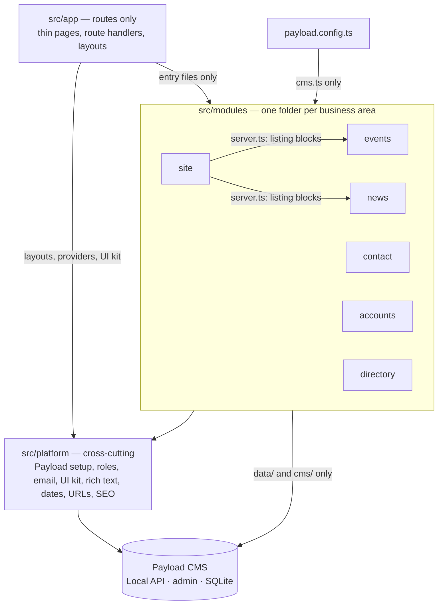

# Architecture

How the Sprecher East website's code is organized, and where new code goes. This is the map for
people and AI agents alike. The rules for _how_ changes are made (issue, PR, review, merge) are in
[`AGENTS.md`](../../AGENTS.md).

> **Status (2026-10-20):** this page describes the **target** structure. The code is moving there
> in small steps, tracked in #127. Until a business area has moved, its code is still in the
> template folders listed in [Where things are today](#where-things-are-today).

## The shape: a modular monolith

One Next.js app with Payload CMS inside it, organized **by business area** (a "module"), each
layered inside. Payload is the storage and the admin screens; the site's own code decides what the
data means and how it's shown.



Why this shape: Next.js recommends a dedicated, server-only Data Access Layer for new projects
([Next.js data security](https://nextjs.org/docs/app/guides/data-security)), and a layered app that
grows should split its top level "into domain oriented modules which are internally layered"
([Fowler](https://martinfowler.com/bliki/PresentationDomainDataLayering.html)). Decision record:
[0001](decisions/0001-modular-monolith.md).

## Business areas

| Module      | Owns                                                                 | Payload collections and globals                  | Routes                                              |
| ----------- | -------------------------------------------------------------------- | ------------------------------------------------ | --------------------------------------------------- |
| `events`    | Event listings, the "upcoming" rule, event types, calendar (Phase 2) | `events`                                         | `/events`, `/events/[slug]`, events sitemap         |
| `news`      | Posts, categories, authors, search, related and recent posts         | `posts`, `categories`, `search`                  | `/posts`, `/posts/[slug]`, `/search`, posts sitemap |
| `contact`   | Public form safeguards, the robot check, form-email rules            | `forms`, `form-submissions` (plugin)             | the form block on CMS pages                         |
| `accounts`  | Who is signed in, roles, sign-in and password flows                  | `users`                                          | `/login`, `/account`                                |
| `directory` | FAQ, local resources, team members                                   | `faq`, `resources`, `team-members`               | `/faq`, `/resources`                                |
| `site`      | CMS pages, page-builder blocks, heroes, header, footer, redirects    | `pages`, `redirects`, globals `header`, `footer` | `/[slug]`, home, pages sitemap                      |
| `comments`  | Resident comments (future)                                           | (future)                                         | (future)                                            |

`src/platform/` holds what every module uses, and imports no module:

- `lib/`: pure helpers for dates, text, URLs and shared content types; no framework, so the domain
  may use them.
- `payload/`: access functions, role checks, reusable fields.
- `ui/`: primitives (`Button`, `Input`, `Media`, `Link`) with their variants.
- `theme/`: the token contract (`tokens.ts`) and the Tailwind mapping.
- `richtext/`: the `RichText` renderer and the blocks that can sit inside rich text (banner, code,
  media, call to action). Pages reuse them from here.
- `email/`, `seo/`, and `media` (uploads).

Routes that serve no single area (`/api/version`, draft preview under `/next/`, the seed route)
belong to `platform`; `app/(payload)/` is Payload's generated admin and API.

## Inside a module

```text
src/modules/events/
  index.ts      client-safe entry: types, pure helpers, components that load no data
  server.ts     server-only entry: use cases (listUpcomingEvents) and components that load data
  actions.ts    server actions ("Load more"); each validates its input and calls a use case
  cms.ts        Payload entry: this area's collection configs, imported only by payload.config.ts
  domain/       types (DTOs included) and rules in plain TypeScript; unit-tested
  data/         server-only Local API queries; map documents to the domain's types
  cms/          collection config, fields and hooks
  ui/           React components and headless hooks (useEventFilters)
```

A module only has the folders it needs. Tests sit next to the file they test (`isUpcoming.test.ts`).

## Layers: the core stays still, the edges can change

The site's core idea (what an event is, what counts as upcoming, who may see a draft) is plain
TypeScript in the middle. Payload, Next.js, outside services and the look sit around it, so each
can be upgraded or replaced without rewriting the core.

| Layer        | Where                                         | Holds                                                                     |
| ------------ | --------------------------------------------- | ------------------------------------------------------------------------- |
| Domain       | `domain/`                                     | Types (DTOs included), rules and calculations. Uses only `platform/lib/`. |
| Application  | `server.ts`, `actions.ts`                     | Use cases: check who is asking, load, apply domain rules, return DTOs.    |
| Adapters     | `data/`, `cms/`, `platform/payload/`, clients | Payload queries and configs, Cloudflare, SMTP.                            |
| Presentation | `app/`, `ui/`, `platform/ui/`                 | Pages and components that render DTOs. No business rules.                 |
| Theme        | `src/themes/default/`                         | Token values: colors, fonts, radius, shadows.                             |

One deliberate shortcut: use cases call `data/` functions directly, not through an interface,
because Payload's Local API is already that abstraction ([0002](decisions/0002-no-repository-layer.md)).
Replacing Payload would mean rewriting `data/` and `cms/`; the domain and the pages stay. A DTO
field that holds rich text or an image uses the type-only `RichTextValue` or `ImageRef` from
`platform/lib/`, which `RichText` and `Media` accept.

What this buys:

- **Another presentation can reuse the core.** Use cases return plain objects, so an iCal feed, a
  JSON route for a future app, or a redesigned UI calls the same `server.ts` functions. Behaviour
  a component needs (filters, paging, open and closed state) lives in a headless hook that renders
  nothing, so it survives a redesign.
- **The look is one file.** Components use semantic token classes (`bg-primary`,
  `text-muted-foreground`). `platform/theme/tokens.ts` lists every token, a test checks the
  theme defines each one in light and dark mode, and a new look means new token values, not
  component edits ([0006](decisions/0006-clean-layers-and-pluggable-themes.md), #146).

## Dependency rules

1. **Inward only.** Presentation → application → domain, and adapters → domain. `domain/` imports
   no framework and nothing from `data/`, `cms/` or `ui/`; it may use `platform/lib/`.
2. **Entry files only.** Outside a module, import it only through its entry files: `index.ts` and
   `actions.ts` from anywhere, `server.ts` from server code, `cms.ts` from `payload.config.ts`.
   `app/` may also import `platform/` directly.
3. **Module to module** only on the allowlist: `site → news` and `site → events` (blocks that list
   posts or events), later `comments → accounts`. Otherwise the page in `app/` combines them, as
   the post page does with upcoming events. `platform/` imports no module.
4. **Server-only code stays out of the CMS config.** `data/` and `server.ts` start with
   `import 'server-only'`, and only `server.ts` and `actions.ts` import `data/`. `cms/` never
   imports `data/`, `server.ts` or anything else server-only: the Payload CLI (migrations, seed)
   loads every hook outside Next.js, where `server-only` throws. Hooks use the `req.payload` they
   are given.
5. **Client components** get DTOs as props and never import `data/` or `server.ts`. To change
   something they call a server action, or one of Payload's own REST endpoints through a small
   client in the owning module (sign-in and passwords in `accounts`, form submissions in
   `contact`, where the robot check runs).
6. **Payload at the edges.** Runtime imports of `payload`, `@payloadcms/*` or `@payload-config`
   are allowed only in `data/`, `cms/`, `platform/` and `payload.config.ts`. `import type` is
   allowed anywhere; the generated `app/(payload)/` and `migrations/` are exempt.
7. **Access is explicit.** Every Local API call passes `overrideAccess`: the Local API skips
   access control by default ([Payload access control](https://payloadcms.com/docs/access-control/overview)).
8. **DTOs out.** `server.ts` returns the module's own types (`EventSummary`, `EventDetail`), never
   raw Payload documents. A read-only list that needs no reshaping (FAQ, resources) may define its
   type as a named `Pick<>` of the generated type, loaded with `select`, instead of a mapper. Code
   that renders CMS content as authored (page-builder blocks, heroes, `RichText`, `Media`) takes
   the generated types, because its shape is the CMS's.
9. **No colors in components.** Semantic token classes only: no palette classes, hex values or
   inline styles. Text and overlays on photos will use `on-image` and `scrim` tokens (#146); until
   then `white` and `black` are allowed there and nowhere else.

How they are checked, from #130 on (warnings until #137): rules 1–3, 5 and 6 and the type part of
8 by ESLint (`eslint-plugin-boundaries`, `no-restricted-imports`); rule 4 by `server-only` at
build time plus a boundaries rule for `cms/`; rule 7 by a lint check for Local API calls
without `overrideAccess` (#145) and review; rule 9 by lint and the theme test (#146). Vitest
aliases `server-only` to an empty module so `data/` mappers can be unit-tested.

## Where does it go?

| You are adding…                                                | Put it in                                                                                                |
| -------------------------------------------------------------- | -------------------------------------------------------------------------------------------------------- |
| A business rule ("what counts as upcoming")                    | the module's `domain/`, with a unit test                                                                 |
| A use case other code calls (list, submit, publish)            | the module's `server.ts` or `actions.ts`, built from `domain/` and `data/`                               |
| A database read or write                                       | the module's `data/`, called only from `server.ts` or `actions.ts`; in a hook, `req.payload`             |
| A color, font, corner radius or shadow                         | a token in `platform/theme/tokens.ts`, with its value in `src/themes/default/`                           |
| A button size, card style or other UI variant                  | the primitive in `platform/ui/` (its `cva` variants), not in the feature component                       |
| A collection, field, or Payload hook                           | the module's `cms/`, exported from `cms.ts` and registered in `payload.config.ts`                        |
| A component used by one module                                 | the module's `ui/`                                                                                       |
| A component or helper used by two or more modules              | `src/platform/` (move it there on the second use)                                                        |
| A page or URL                                                  | `src/app/`, as a thin file that calls a module                                                           |
| An outside service (Cloudflare, Mailgun, a city calendar feed) | an interface in the module, an adapter beside it ([conventions](conventions.md#interfaces-and-adapters)) |

## Where things are today

Until each step of #127 lands, code lives in the Payload website template's folders, sorted by
technical type: `src/collections/`, `src/components/`, `src/blocks/`, `src/heros/`, `src/hooks/`,
`src/utilities/`, `src/access/`, `src/fields/`, `src/Header/`, `src/Footer/`, `src/search/`,
`src/plugins/`, `src/providers/`, `src/endpoints/` (seed). When you touch code there, don't add
new duplication; if your change needs a rule that already exists elsewhere, reuse it.

New code for an area that hasn't moved yet goes in its future module, with only the folders it
needs (for example `src/modules/events/domain/isUpcoming.ts`), and the old code imports it from
there. Don't add new files to the template folders.

## More

- [Conventions](conventions.md): naming, entry files, interfaces, file size, tests.
- [Glossary](glossary.md): business terms, defined once.
- [Data model](data-model.md): every collection and global, its fields and its access rules.
- [Decision records](decisions/README.md): why things are the way they are.
