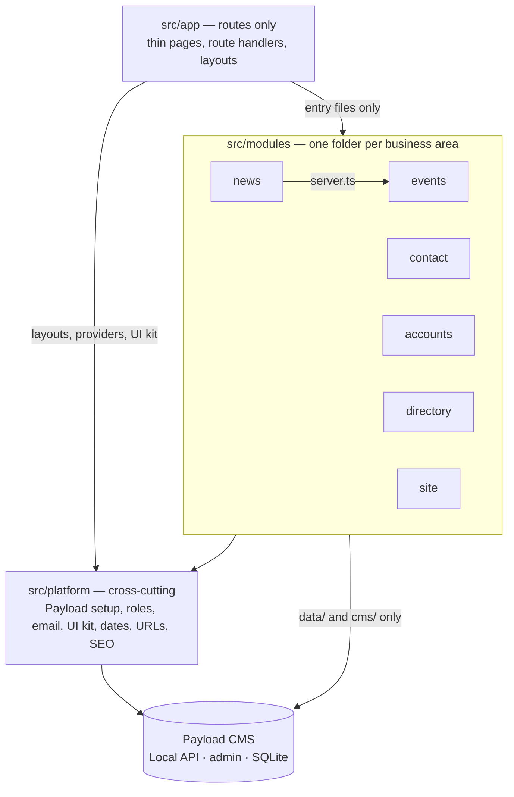

# Architecture

How the Sprecher East website's code is organized, and where new code goes. This is the map for
people and AI agents alike. The rules for _how_ changes are made (issue, PR, review, merge) are in
[`AGENTS.md`](../../AGENTS.md).

> **Status (2026-10-20):** this page describes the **target** structure. The code is moving there
> in small steps, tracked in #127. Until a business area has moved, its code is still in the
> template folders listed in [Where things are today](#where-things-are-today).

## The shape: a modular monolith

One Next.js app with Payload CMS inside it, organized **by business area** (a "module"), each
layered inside. Payload is the storage and the admin screens; the site's own code decides what the
data means and how it's shown.



Why this shape: Next.js recommends a dedicated, server-only Data Access Layer for new projects
([Next.js data security](https://nextjs.org/docs/app/guides/data-security)), and a layered app that
grows should split its top level "into domain oriented modules which are internally layered"
([Fowler](https://martinfowler.com/bliki/PresentationDomainDataLayering.html)). Decision record:
[0001](decisions/0001-modular-monolith.md).

## Business areas

| Module      | Owns                                                                 | Payload collections and globals                  | Routes                                              |
| ----------- | -------------------------------------------------------------------- | ------------------------------------------------ | --------------------------------------------------- |
| `events`    | Event listings, the "upcoming" rule, event types, calendar (Phase 2) | `events`                                         | `/events`, `/events/[slug]`, events sitemap         |
| `news`      | Posts, categories, authors, search, related and recent posts         | `posts`, `categories`, `search`                  | `/posts`, `/posts/[slug]`, `/search`, posts sitemap |
| `contact`   | Public form safeguards, the robot check, form-email rules            | `forms`, `form-submissions` (plugin)             | the form block on CMS pages                         |
| `accounts`  | Who is signed in, roles, sign-in and password flows                  | `users`                                          | `/login`, `/account`                                |
| `directory` | FAQ, local resources, team members                                   | `faq`, `resources`, `team-members`               | `/faq`, `/resources`                                |
| `site`      | CMS pages, page-builder blocks, heroes, header, footer, redirects    | `pages`, `redirects`, globals `header`, `footer` | `/[slug]`, home, pages sitemap                      |
| `comments`  | Resident comments (future)                                           | (future)                                         | (future)                                            |

`src/platform/` holds what every module uses: the Payload client and config pieces, role checks
and access functions, the email transport, UI primitives (`Button`, `Input`, `Media`, `Link`,
`RichText`), and helpers for dates, URLs and SEO. `media` (uploads) is platform too. Routes
that serve no single area (`/api/version`, draft preview under `/next/`, the seed route) belong
to `platform`; `app/(payload)/` is Payload's generated admin and API.

## Inside a module

```text
src/modules/events/
  index.ts      client-safe entry: types, pure helpers and UI parts other code may import
  server.ts     server-only entry: the use cases other code calls (listUpcomingEvents)
  actions.ts    server actions ("Load more", form posts); thin, they call the same use cases
  domain/       types and rules in plain TypeScript (no Next.js, React or Payload); unit-tested
  data/         server-only queries and mutations over Payload's Local API; return the module's own types
  cms/          the Payload collection config, fields and hooks for this area
  ui/           React components for this area, plus headless hooks (useEventFilters)
```

A module only has the folders it needs. Tests sit next to the file they test (`isUpcoming.test.ts`).

## Layers: the core stays still, the edges can change

The site's core idea (what an event is, what counts as upcoming, who may see a draft) is plain
TypeScript in the middle. Payload, Next.js, outside services and the look sit around it, and each
can be upgraded or replaced without rewriting the core. Dependencies only point inward.

| Layer        | Where                                                 | Holds                                                                                                  |
| ------------ | ----------------------------------------------------- | ------------------------------------------------------------------------------------------------------ |
| Domain       | `domain/`                                             | Types, rules and calculations. Imports only other domain code and pure `platform/` helpers (dates).    |
| Application  | `server.ts`, `actions.ts`                             | Use cases: check who is asking, load through `data/`, apply domain rules, return plain objects (DTOs). |
| Adapters     | `data/`, `cms/`, `platform/payload/`, service clients | Payload queries and configs, Cloudflare, SMTP. Swappable behind the application layer.                 |
| Presentation | `app/`, `ui/`, `platform/ui/`                         | Pages and components. They receive DTOs and render them; they hold no business rules.                  |
| Theme        | `src/themes/<name>/`                                  | Token values: colors, fonts, radius, shadows. Components never name a color.                           |

Two consequences matter most:

- **Another presentation can reuse the core.** Because use cases return plain objects, an iCal
  feed, a JSON route for a future app, or a redesigned UI kit calls the same `server.ts`
  functions. Behaviour a component needs (filters, paging, open and closed state) lives in a
  headless hook that renders nothing, so it survives a redesign.
- **A theme is a file, not a refactor.** Components use semantic token classes
  (`bg-primary`, `text-muted-foreground`). `platform/theme/tokens.ts` lists the tokens every theme
  must define, a test checks each theme against that list in light and dark mode, and changing
  the look means adding a theme folder ([0006](decisions/0006-clean-layers-and-pluggable-themes.md),
  #146).

## Dependency rules

1. **Inward only.** Presentation → application → domain. Adapters depend on the domain, never the
   reverse. `domain/` imports nothing from Next.js, React, Payload, `data/`, `cms/` or `ui/`.
2. **Entry files only.** Code outside a module imports it only through `index.ts`, `server.ts`
   or `actions.ts`. `app/` may also import `platform/` directly (layouts, providers, the UI kit).
3. **Module to module** only for pairs on the allowlist: `news → events` (upcoming events beside
   a post), `site → news` and `site → events` (page-builder blocks that list posts or events),
   later `comments → accounts`. Otherwise the page in `app/` combines them.
4. **Data stays on the server.** Only `server.ts`, `actions.ts` and `cms/` hooks import `data/`. Server
   components call `server.ts`; client components get DTOs as props and change things through
   `actions.ts`. `data/` and `server.ts` start with `import 'server-only'`, so a slip fails the
   build.
5. **Payload at the edges.** Runtime imports of `payload`, `@payloadcms/*` or `@payload-config`
   are allowed only in `data/`, `cms/`, `platform/` and `payload.config.ts`. `import type` is
   allowed anywhere; the generated `app/(payload)/` and `migrations/` are exempt.
6. **Access is explicit.** Every Local API call passes `overrideAccess`: Payload's Local API
   skips access control by default
   ([Payload access control](https://payloadcms.com/docs/access-control/overview)).
7. **DTOs out.** `server.ts` returns the module's own types (`EventSummary`, `EventDetail`), never
   raw Payload documents. The exception is code that renders CMS content as it was authored
   (page-builder blocks, heroes, `RichText`, `Media`): its shape is the CMS's, so it takes the
   generated Payload types.
8. **No colors in components.** Semantic token classes only; no palette classes (`bg-gray-500`),
   hex values or inline styles. The one exception is black overlays (scrims) on photos.

Rules 1–5 are checked by ESLint (`eslint-plugin-boundaries`) and the `server-only` package from
#130 on, rule 8 from #146; they are warnings until #137.

## Where does it go?

| You are adding…                                                | Put it in                                                                                                |
| -------------------------------------------------------------- | -------------------------------------------------------------------------------------------------------- |
| A business rule ("what counts as upcoming")                    | the module's `domain/`, with a unit test                                                                 |
| A use case other code calls (list, submit, publish)            | the module's `server.ts` or `actions.ts`, built from `domain/` and `data/`                               |
| A database read or write                                       | the module's `data/`, called only from `server.ts` or `actions.ts`                                       |
| A color, font, corner radius or shadow                         | a token in `platform/theme/tokens.ts`, with values in each theme under `src/themes/`                     |
| A button size, card style or other UI variant                  | the primitive in `platform/ui/` (its `cva` variants), not in the feature component                       |
| A collection, field, or Payload hook                           | the module's `cms/`, registered in `payload.config.ts`                                                   |
| A component used by one module                                 | the module's `ui/`                                                                                       |
| A component or helper used by two or more modules              | `src/platform/` (move it there on the second use)                                                        |
| A page or URL                                                  | `src/app/`, as a thin file that calls a module                                                           |
| An outside service (Cloudflare, Mailgun, a city calendar feed) | an interface in the module, an adapter beside it ([conventions](conventions.md#interfaces-and-adapters)) |

## Where things are today

Until each step of #127 lands, code lives in the Payload website template's folders, sorted by
technical type: `src/collections/`, `src/components/`, `src/blocks/`, `src/heros/`, `src/hooks/`,
`src/utilities/`, `src/access/`, `src/fields/`, `src/Header/`, `src/Footer/`, `src/search/`,
`src/plugins/`, `src/providers/`, `src/endpoints/` (seed). When you touch code there, don't add
new duplication; if your change needs a rule that already exists elsewhere, reuse it.

## More

- [Conventions](conventions.md): naming, entry files, interfaces, file size, tests.
- [Glossary](glossary.md): business terms, defined once.
- [Data model](data-model.md): every collection and global, its fields and its access rules.
- [Decision records](decisions/README.md): why things are the way they are.
