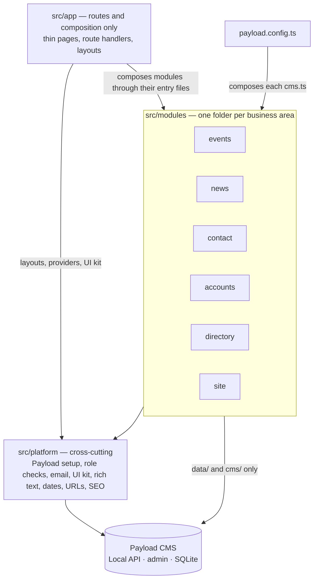

# Architecture

How the Sprecher East website's code is organized, and where new code goes. This is the map for
people and AI agents alike. The rules for _how_ changes are made (issue, PR, review, merge) are in
[`AGENTS.md`](../../AGENTS.md).

> **Status (2026-10-20):** this page describes the **target** structure. The code is moving there
> in small steps, tracked in #127. Until a business area has moved, its code is still in the
> template folders listed in [Where things are today](#where-things-are-today).

## The shape: a modular monolith

One Next.js app with Payload CMS inside it, organized **by business area** (a "module"), each
layered inside. Payload is the storage and the admin screens; the site's own code decides what the
data means and how it's shown.



Why this shape: Next.js recommends a dedicated, server-only Data Access Layer for new projects
([Next.js data security](https://nextjs.org/docs/app/guides/data-security)), and a layered app that
grows should split its top level "into domain oriented modules which are internally layered"
([Fowler](https://martinfowler.com/bliki/PresentationDomainDataLayering.html)). Decision record:
[0001](decisions/0001-modular-monolith.md).

## Business areas

| Module      | Owns                                                                 | Payload collections and globals                  | Routes                                              |
| ----------- | -------------------------------------------------------------------- | ------------------------------------------------ | --------------------------------------------------- |
| `events`    | Event listings, the "upcoming" rule, event types, calendar (Phase 2) | `events`                                         | `/events`, `/events/[slug]`, events sitemap         |
| `news`      | Posts, categories, authors, search, related and recent posts         | `posts`, `categories`, `search`                  | `/posts`, `/posts/[slug]`, `/search`, posts sitemap |
| `contact`   | Public form safeguards, the robot check, form-email rules            | `forms`, `form-submissions` (plugin)             | the form block on CMS pages                         |
| `accounts`  | Who is signed in, sign-in and password flows, the role field         | `users`                                          | `/login`, `/account`                                |
| `directory` | FAQ, local resources, team members                                   | `faq`, `resources`, `team-members`               | `/faq`, `/resources`                                |
| `site`      | CMS pages, page-builder blocks, heroes, header, footer, redirects    | `pages`, `redirects`, globals `header`, `footer` | `/[slug]`, home, pages sitemap                      |
| `comments`  | Resident comments (future)                                           | (future)                                         | (future)                                            |

`src/platform/` holds what every module uses, and imports no module:

- `lib/`: pure helpers for dates, text, URLs and shared content types; no framework, so the domain
  may use them.
- `payload/`: role checks and access functions (every module uses them), reusable fields, and
  plugins no single module owns (SEO).
- `ui/`: primitives (`Button`, `Input`, `Media`, `Link`) with their variants.
- `theme/`: the token contract (`tokens.ts`) and the Tailwind mapping.
- `richtext/`: the `RichText` renderer and the blocks that can sit inside rich text (banner, code,
  media, call to action). Pages reuse them from here.
- `email/`, `seo/`, and `media` (uploads).

Routes that serve no single area (`/api/version`, draft preview under `/next/`, the seed route)
belong to `platform`; `app/(payload)/` is Payload's generated admin and API.

## Inside a module

```text
src/modules/events/
  index.ts      types and pure rules only: safe for the proxy, client components and scripts
  server.ts     server-only entry: re-exports use cases and the components pages render
  actions.ts    server actions ("Load more"); each validates its input and calls a use case
  cms.ts        Payload entry: collection and global configs, blocks, plugin setup for this area
  domain/       types (DTOs included) and rules in plain TypeScript; unit-tested
  use-cases/    findUpcomingEvents: check who is asking, load through data/, apply rules, return DTOs
  data/         Local API queries; map documents to the domain's types
  cms/          collection config, fields, hooks, plugin options, admin components (RowLabel)
  ui/           React components, headless hooks (useEventFilters), and a browser client for
                Payload's REST endpoints if the module needs one (ui/api.ts)
```

Entry files are for code outside the module. Inside it, import the folder you need directly, so
the entry files never import each other. The one exception: `ui/` may import its own module's
`actions.ts`, because server actions must live in a `'use server'` file (the "Load more" feeds).
`index.ts` exports only types and pure rules from `domain/`, so importing it never pulls in React,
Payload or server-only code; lint forbids it from re-exporting `ui/`. The components pages render
are exported from `server.ts`. If a client component outside the module ever needs one of the
module's components, add a client-safe entry for them then.

A module only has the folders it needs. Tests sit next to the file they test (`categories.test.ts`).

## Layers: the core stays still, the edges can change

The site's core idea (what an event is, which categories it can have, who may see a draft) is plain
TypeScript in the middle. Payload, Next.js, outside services and the look sit around it, so each
can be upgraded or replaced without rewriting the core.

| Layer        | Where                                         | Holds                                                                     |
| ------------ | --------------------------------------------- | ------------------------------------------------------------------------- |
| Domain       | `domain/`                                     | Types (DTOs included), rules and calculations. Uses only `platform/lib/`. |
| Application  | `use-cases/`, `actions.ts`                    | Use cases: check who is asking, load, apply domain rules, return DTOs.    |
| Adapters     | `data/`, `cms/`, `platform/payload/`, clients | Payload queries and configs, Cloudflare, SMTP.                            |
| Presentation | `app/`, `ui/`, `platform/ui/`                 | Pages and components that render DTOs. No business rules.                 |
| Theme        | `src/themes/default/`                         | Token values: colors, fonts, radius, shadows.                             |

One deliberate shortcut: use cases call `data/` functions directly, not through an interface,
because Payload's Local API is already that abstraction ([0002](decisions/0002-no-repository-layer.md)).
Replacing Payload would mean rewriting `data/` and `cms/`; the domain and the pages stay. A DTO
field that holds rich text or an image uses the type-only `RichTextValue` or `ImageRef` from
`platform/lib/`, which `RichText` and `Media` accept.

What this buys:

- **Another presentation can reuse the core.** Use cases return plain objects, so an iCal feed, a
  JSON route for a future app, or a redesigned UI calls the same use cases. Behaviour
  a component needs (filters, paging, open and closed state) lives in a headless hook that renders
  nothing, so it survives a redesign.
- **The look is one file.** Components use semantic token classes (`bg-primary`,
  `text-muted-foreground`). `platform/theme/tokens.ts` lists every token, a test checks the
  theme defines each one in light and dark mode, and a new look means new token values, not
  component edits ([0006](decisions/0006-clean-layers-and-pluggable-themes.md), #146).

## Dependency rules

1. **Inward only.** Presentation (`ui/`, `app/`) → application (`use-cases/`, `actions.ts`) →
   domain, and adapters (`data/`, `cms/`) → domain. `domain/` imports no framework and nothing
   from `data/`, `cms/` or `ui/`; it may use `platform/lib/`.
2. **Entry files only.** Outside a module, import it only through its entry files: `index.ts`
   (types and pure rules) from anywhere, including `src/proxy.ts` and client components;
   `actions.ts` from `app/`; `server.ts` from server code in `app/`; and `cms.ts` from
   `payload.config.ts`. `app/` may also import `platform/` directly. Until an area moves (#127),
   the template folders may import a module's entry files too.
3. **No module imports another.** Modules meet only in the composition roots: pages, layouts
   and the block registry in `app/`, and `payload.config.ts`
   ([0008](decisions/0008-compose-modules-at-the-app-level.md)). For example, the post page calls
   `news` and `events` and passes both results to its components, and `payload.config.ts` hands
   the form block from `contact` to `site`'s Pages collection factory. `platform/` imports no
   module.
4. **Server-only code stays out of the CMS config.** `data/`, `use-cases/` and `server.ts` start
   with `import 'server-only'`, and only `use-cases/` and `actions.ts` import `data/`. `cms/` and
   `cms.ts` never reach anything server-only: the Payload CLI (migrations, seed) loads every hook
   outside Next.js, where `server-only` throws. Hooks use the `req.payload` they are given.
5. **Client components** get DTOs as props and never import `data/`, `use-cases/` or `server.ts`.
   To change something they call a server action, or one of Payload's own REST endpoints through
   the owning module's browser client (`ui/api.ts`: sign-in and passwords in `accounts`, form
   submissions in `contact`, where the robot check runs).
6. **Payload at the edges.** Runtime imports of `payload`, `@payloadcms/*` or `@payload-config`
   are allowed only in `data/`, `cms/`, `platform/` and `payload.config.ts`. `import type` is
   allowed anywhere. The generated `app/(payload)/` (including the admin import map, which loads
   admin components by path) and `migrations/` are exempt from this rule and rule 2.
7. **Access is explicit.** Every Local API call passes `overrideAccess`: the Local API skips
   access control by default ([Payload access control](https://payloadcms.com/docs/access-control/overview)).
8. **DTOs out.** Use cases return the module's own types (`EventSummary`, `EventDetail`), never
   raw Payload documents. A read-only list that needs no reshaping (FAQ, resources) may skip the
   mapper: its query loads the fields with `select` and returns the result as it is. Its type is
   either a named `Pick<>` of the generated type or a hand-written type in `domain/` that mirrors
   those fields; prefer the hand-written one. It keeps `@/payload-types` out of the domain and is
   still checked, because the `select`-narrowed result must be assignable to it, so a field that
   drifts fails `tsc`. Code that renders CMS content as authored (page-builder blocks, heroes,
   `RichText`, `Media`) takes the generated types, because its shape is the CMS's.
9. **No colors in components.** Semantic token classes only: `text-primary-foreground` on
   `bg-primary`, never `text-white`; no palette classes, hex values or inline styles. Text and
   overlays on photos will use `on-image` and `scrim` tokens (#146); until then `white` and `black`
   are allowed there only. #146 also replaces the existing raw colors. Where
   [`ui-ux-design.md`](../guidelines/ui-ux-design.md) or the
   [frontend patterns](../guidelines/frontend-patterns/README.md) use raw `white` or `black`
   anywhere but text and overlays on photos, this rule wins until #146 updates them.

How they are checked (warnings until #137): [`eslint.boundaries.config.mjs`](../../eslint.boundaries.config.mjs)
checks the imports in rules 1–3 and 6 and the `cms/` part of rule 4. For the rest of rule 4,
`server-only` fails the build when browser code imports server code, and CI's `payload migrate`
fails when the CMS config reaches it. Review covers rules 5, 7 and 8 (#137 adds a lint check for
`overrideAccess`); rule 9 comes with lint and the theme test (#146). Vitest aliases
`server-only` to an empty module so `data/` mappers can be unit-tested.

## Where does it go?

| You are adding…                                                | Put it in                                                                                                |
| -------------------------------------------------------------- | -------------------------------------------------------------------------------------------------------- |
| A business rule (the event categories, `isEventScope`)         | the module's `domain/`, with a unit test                                                                 |
| A use case other code calls (list, submit, publish)            | the module's `use-cases/`, exported from `server.ts`; a server action in `actions.ts` calls it           |
| A database read or write                                       | the module's `data/`, called only from `use-cases/` or `actions.ts`; in a hook, `req.payload`            |
| A color, font, corner radius or shadow                         | a token in `platform/theme/tokens.ts`, with its value in `src/themes/default/`                           |
| A button size, card style or other UI variant                  | the primitive in `platform/ui/` (its `cva` variants), not in the feature component                       |
| A collection, field, Payload hook or plugin option             | the module's `cms/`, exported from `cms.ts` and registered in `payload.config.ts`                        |
| A component used by one module                                 | the module's `ui/`                                                                                       |
| A component or helper used by two or more modules              | `src/platform/` (move it there on the second use)                                                        |
| A page or URL                                                  | `src/app/`, as a thin file that calls a module                                                           |
| Code where two modules meet                                    | `src/app/` (a page, layout or the block registry) or `payload.config.ts`, never inside a module          |
| An outside service (Cloudflare, Mailgun, a city calendar feed) | an interface in the module, an adapter beside it ([conventions](conventions.md#interfaces-and-adapters)) |

A rule the site only ever applies as a query filter, like the events upcoming rule (`inScope` in
`src/modules/events/data/scope.ts`), may live only in `data/`, as the function that builds the
`Where`, with its own unit test. Don't also write it as a pure function in `domain/`: two copies
drift, and the tested one may not be the one that runs.

## Where things are today

Until each step of #127 lands, code lives in the Payload website template's folders, sorted by
technical type: `src/collections/`, `src/components/`, `src/blocks/`, `src/heros/`, `src/hooks/`,
`src/utilities/`, `src/access/`, `src/fields/`, `src/Header/`, `src/Footer/`, `src/search/`,
`src/plugins/`, `src/providers/`, `src/endpoints/` (seed). When you touch code there, don't add
new duplication; if your change needs a rule that already exists elsewhere, reuse it.

New code for an area that hasn't moved yet goes in its future module, with only the folders it
needs (for example `src/modules/events/domain/categories.ts` plus an `index.ts` that exports it),
and the old code imports it through that entry file. Where [`docs/guidelines/payload-cms.md`](../guidelines/payload-cms.md)
names a template folder, it describes today's code; new code follows this page.

## More

- [Conventions](conventions.md): naming, entry files, interfaces, file size, tests.
- [Glossary](glossary.md): business terms, defined once.
- [Data model](data-model.md): every collection and global, its fields and its access rules.
- [Decision records](decisions/README.md): why things are the way they are.
