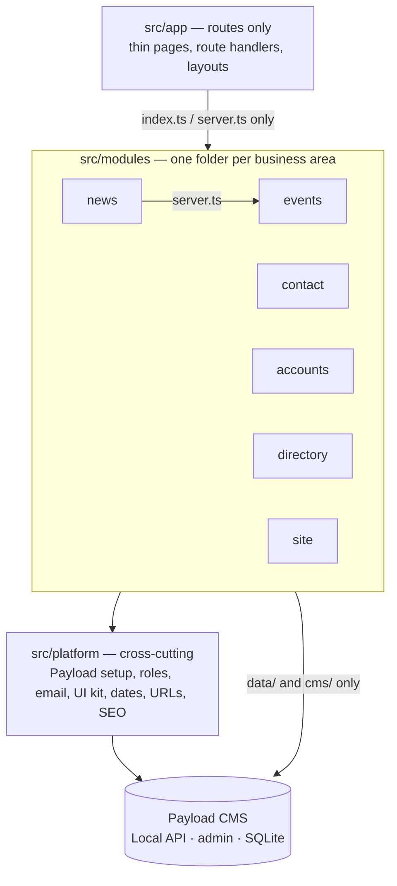

# Architecture

How the Sprecher East website's code is organized, and where new code goes. This is the map for
people and AI agents alike. The rules for _how_ changes are made (issue, PR, review, merge) are in
[`AGENTS.md`](../../AGENTS.md).

> **Status (2026-10-20):** this page describes the **target** structure. The code is moving there
> in small steps, tracked in #127. Until a business area has moved, its code is still in the
> template folders listed in [Where things are today](#where-things-are-today).

## The shape: a modular monolith

One Next.js app with Payload CMS inside it, organized **by business area** (a "module"), each
layered inside. Payload is the storage and the admin screens; the site's own code decides what the
data means and how it's shown.



Why this shape: Next.js recommends a dedicated, server-only Data Access Layer for new projects
([Next.js data security](https://nextjs.org/docs/app/guides/data-security)), and a layered app that
grows should split its top level "into domain oriented modules which are internally layered"
([Fowler](https://martinfowler.com/bliki/PresentationDomainDataLayering.html)). Decision record:
[0001](decisions/0001-modular-monolith.md).

## Business areas

| Module      | Owns                                                                | Payload collections and globals                  | Routes                                              |
| ----------- | ------------------------------------------------------------------- | ------------------------------------------------ | --------------------------------------------------- |
| `events`    | Event listings, the "upcoming" rule, categories, calendar (Phase 2) | `events`                                         | `/events`, `/events/[slug]`, events sitemap         |
| `news`      | Posts, categories, authors, search, related and recent posts        | `posts`, `categories`, `search`                  | `/posts`, `/posts/[slug]`, `/search`, posts sitemap |
| `contact`   | Public form safeguards, the robot check, form-email rules           | `forms`, `form-submissions` (plugin)             | the form block on CMS pages                         |
| `accounts`  | Who is signed in, roles, sign-in and password flows                 | `users`                                          | `/login`, `/account`                                |
| `directory` | FAQ, local resources, team members                                  | `faq`, `resources`, `team-members`               | `/faq`, `/resources`                                |
| `site`      | CMS pages, page-builder blocks, heroes, header, footer, redirects   | `pages`, `redirects`, globals `header`, `footer` | `/[slug]`, home, pages sitemap                      |
| `comments`  | Resident comments (future)                                          | (future)                                         | (future)                                            |

`src/platform/` holds what every module uses: the Payload client and config pieces, role checks
and access functions, the email transport, UI primitives (`Button`, `Input`, `Media`, `Link`,
`RichText`), and helpers for dates, URLs and SEO. `media` (uploads) is platform too.

## Inside a module

```text
src/modules/events/
  index.ts      client-safe entry: types and UI parts other code may import
  server.ts     server-only entry: queries and actions other code may call
  domain/       pure rules and types (no Next.js, no Payload); unit-tested
  data/         server-only queries and mutations over Payload's Local API; return the module's own types
  cms/          the Payload collection config, fields and hooks for this area
  ui/           React components for this area
  actions.ts    server actions ("Load more", form posts); thin, they call data/
```

A module only has the folders it needs. Tests sit next to the file they test (`isUpcoming.test.ts`).

## Dependency rules

1. Imports flow one way: `app` → a module's `index.ts` or `server.ts` → `platform`. Never back up.
2. A module uses another module only through that module's entry files, and only for pairs on the
   allowlist: `news → events` (upcoming events beside a post), later `comments → accounts`.
   Otherwise the page in `app/` combines them.
3. Inside a module: `ui` → `data` → `cms` and `platform`. `domain/` imports nothing from Next.js,
   React or Payload.
4. Only `data/`, `cms/`, `platform/payload/` and `payload.config.ts` import Payload.
5. Every `data/` file starts with `import 'server-only'` and passes `overrideAccess` explicitly:
   Payload's Local API skips access control by default
   ([Payload access control](https://payloadcms.com/docs/access-control/overview)).
6. Pages and client components receive the module's own types (for example `EventSummary`),
   never raw Payload documents.

These rules are checked by ESLint (`eslint-plugin-boundaries`) and by the `server-only` package
from #130 on; until #137 they are warnings.

## Where does it go?

| You are adding…                                                | Put it in                                                                                                |
| -------------------------------------------------------------- | -------------------------------------------------------------------------------------------------------- |
| A business rule ("what counts as upcoming")                    | the module's `domain/`, with a unit test                                                                 |
| A database read or write                                       | the module's `data/`, exported via `server.ts`                                                           |
| A collection, field, or Payload hook                           | the module's `cms/`, registered in `payload.config.ts`                                                   |
| A component used by one module                                 | the module's `ui/`                                                                                       |
| A component or helper used by two or more modules              | `src/platform/` (move it there on the second use)                                                        |
| A page or URL                                                  | `src/app/`, as a thin file that calls a module                                                           |
| An outside service (Cloudflare, Mailgun, a city calendar feed) | an interface in the module, an adapter beside it ([conventions](conventions.md#interfaces-and-adapters)) |

## Where things are today

Until each step of #127 lands, code lives in the Payload website template's folders, sorted by
technical type: `src/collections/`, `src/components/`, `src/blocks/`, `src/heros/`, `src/hooks/`,
`src/utilities/`, `src/access/`, `src/fields/`, `src/Header/`, `src/Footer/`, `src/search/`,
`src/plugins/`, `src/providers/`, `src/endpoints/` (seed). When you touch code there, don't add
new duplication; if your change needs a rule that already exists elsewhere, reuse it.

## More

- [Conventions](conventions.md): naming, entry files, interfaces, file size, tests.
- [Glossary](glossary.md): business terms, defined once.
- [Data model](data-model.md): every collection and global, its fields and its access rules.
- [Decision records](decisions/README.md): why things are the way they are.
